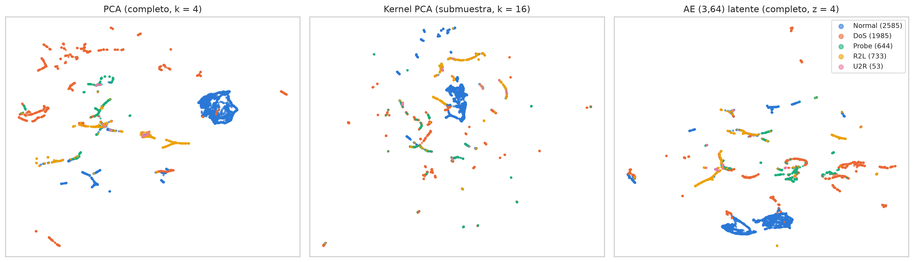
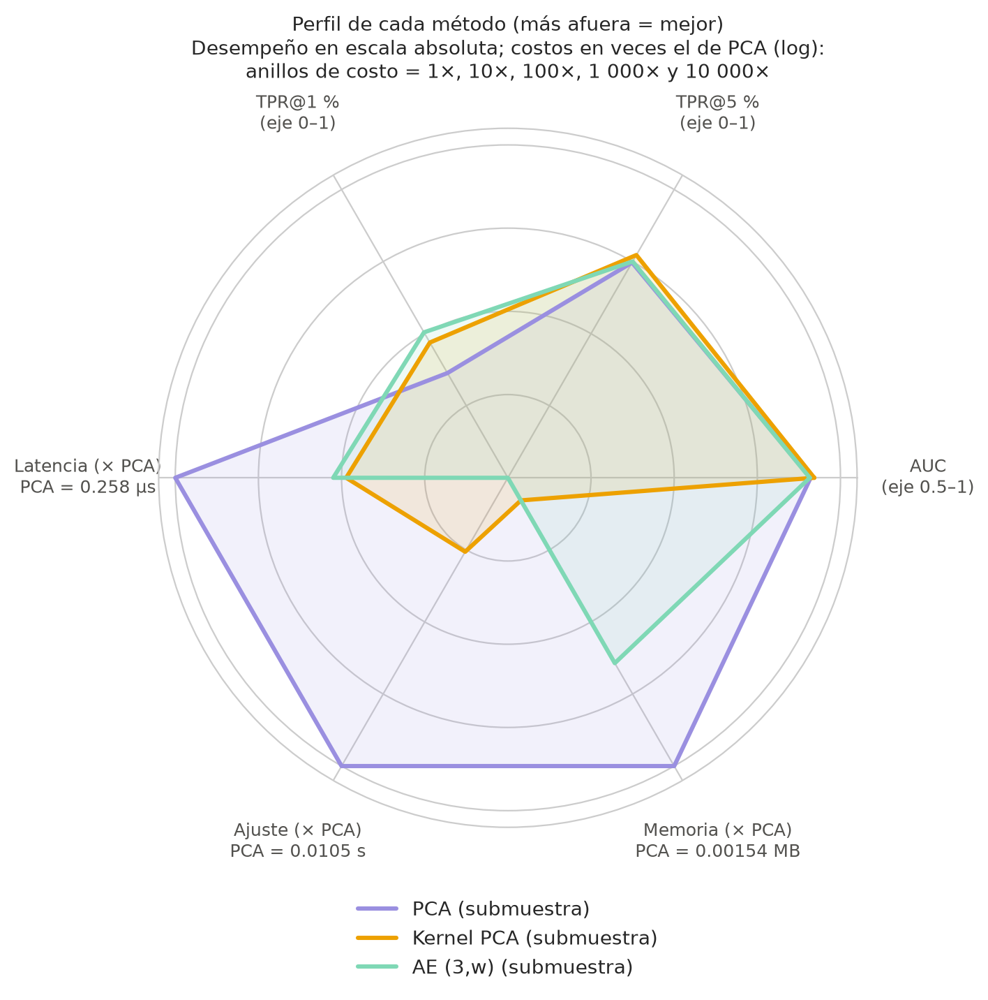

```{r setup, include=FALSE}
knitr::opts_chunk$set(echo = FALSE, message = FALSE, warning = FALSE)
```

<!-- ============================================================= -->
<!-- PORTADA    -->
<!-- ============================================================= -->

\begin{titlepage}
\thispagestyle{empty}

\begin{tikzpicture}[remember picture, overlay]
  \fill[extVerde] (current page.north west) rectangle
       ($(current page.north east)+(0,-6.2cm)$);
  \fill[extGris] ($(current page.north west)+(0,-6.2cm)$) rectangle
       ($(current page.north east)+(0,-6.35cm)$);
  \node[anchor=north west, align=left, inner sep=0pt]
    at ($(current page.north west)+(2.6cm,-2.2cm)$)
    {\sffamily\bfseries\color{white}\LARGE UNIVERSIDAD EXTERNADO DE COLOMBIA\\[0.35cm]
     \sffamily\color{white}\Large Departamento de Matemáticas --- Pregrado en Ciencia de Datos};
\end{tikzpicture}

\vspace*{7.5cm}

\begin{flushleft}
{\sffamily\bfseries\color{extGris}\large INFORME TÉCNICO FINAL\par}
\vspace{0.35cm}
{\color{extVerde}\rule{3.2cm}{2pt}\par}
\vspace{0.9cm}

{\sffamily\bfseries\color{extNegro}\LARGE
Autoencoders frente a métodos de solución cerrada para la detección de intrusiones en red\par}

\vspace{0.8cm}
{\itshape\large\color{extGris}
Auditoría del aporte del aprendizaje profundo en NSL-KDD: PCA, kernel PCA y autoencoder a igual capacidad.\par}
\end{flushleft}

\vfill

\begin{flushleft}
{\sffamily\normalsize\color{extNegro}%
\setlength{\tabcolsep}{0pt}%
\renewcommand{\arraystretch}{1.5}%
\begin{tabular}{@{}ll@{}}
\makebox[5cm][l]{\color{extVerde}\bfseries Autor}    & Yeiver Estevan Sanabria Sánchez\\
\makebox[4.2cm][l]{\color{extVerde}\bfseries Programa} & Pregrado en Ciencia de Datos\\
\makebox[4.2cm][l]{\color{extVerde}\bfseries Profesor} & Wilmer Pineda Ríos\\
\end{tabular}\par}
\end{flushleft}

\vspace{1.2cm}

\begin{tikzpicture}[remember picture, overlay]
  \fill[extVerde] (current page.south west) rectangle
       ($(current page.south east)+(0,1.6cm)$);
  \node[anchor=west, inner sep=0pt]
    at ($(current page.south west)+(2.6cm,0.8cm)$)
    {\sffamily\footnotesize\color{white} Noviembre de 2026};
  \node[anchor=east, inner sep=0pt]
    at ($(current page.south east)+(-2.6cm,0.8cm)$)
    {\sffamily\footnotesize\color{white} Versión 2.0 \quad·\quad Entrega final};
\end{tikzpicture}

\end{titlepage}

<!-- ===================== CUERPO ===================== -->

```{r datos, include=FALSE}
library(ggplot2)
library(knitr)
library(kableExtra)

knitr::opts_chunk$set(dev = "cairo_pdf", fig.pos = "!htb", out.extra = "")

# Paleta (validada para fondo claro): un color por método
COL_PCA <- "#eb6834"; COL_KPCA <- "#2a78d6"; COL_AE <- "#1baf7a"
TINTA <- "#1A1A1A"; TINTA_2 <- "#58595B"; REJILLA <- "#E6E6E3"

tema <- theme_minimal(base_size = 9, base_family = "Lato") +
  theme(panel.grid.minor = element_blank(),
        panel.grid.major = element_line(color = REJILLA, linewidth = 0.3),
        axis.text = element_text(color = TINTA_2),
        axis.title = element_text(color = TINTA_2),
        strip.text = element_text(color = TINTA, face = "bold"),
        legend.position = "top", legend.title = element_blank(),
        legend.text = element_text(color = TINTA),
        plot.margin = margin(4, 8, 4, 4))

leer <- function(f) read.csv(file.path("resultados", "aportes", f), fileEncoding = "UTF-8",
                             check.names = FALSE)
f3 <- function(x) formatC(x, format = "f", digits = 3)
f4 <- function(x) formatC(x, format = "f", digits = 4, flag = "+")

# Resultados del experimento de aportes (experimento_aportes.ipynb)
pca      <- leer("pca.csv")
kpca     <- leer("kernel_pca.csv")
ae3      <- leer("ae_3w_corridas.csv")
hist_ae  <- leer("ae_3w_historial.csv")
aportes  <- leer("igual_capacidad_aportes.csv")
por_k    <- leer("igual_capacidad_aportes_por_k.csv")
auc_ic   <- leer("auc_igual_capacidad_ic.csv")
tpr_ic   <- leer("tpr_igual_capacidad.csv")
tpr_ap   <- leer("tpr_igual_capacidad_aportes.csv")
cat_auc  <- leer("igual_capacidad_categorias.csv")
brecha   <- leer("brecha_validacion_test.csv")
costo    <- leer("costo.csv")
seleccion <- leer("seleccion.csv")

# Acceso rápido a un aporte por su nombre
ap <- function(nombre) aportes[aportes$aporte == nombre, ]
ap_kpca <- ap("No linealidad fija")
ap_grad <- ap("Representación aprendida (gradiente)")
ap_dae  <- ap("Más datos: AE")
ap_dpca <- ap("Más datos: PCA")
ap_tot  <- ap("Total deep learning (AE − PCA, completo)")
sel <- function(m) seleccion[seleccion$método == m, ]
cst <- function(m) costo[costo$método == m, ]

# Orden y color de los métodos en las figuras
METODOS <- c("PCA (completo)", "PCA (submuestra)", "Kernel PCA (submuestra)",
             "AE (3,w) (completo)", "AE (3,w) (submuestra)")
color_metodo <- setNames(c(COL_PCA, COL_PCA, COL_KPCA, COL_AE, COL_AE), METODOS)

# Recuadro de conclusiones (mismo formato que la entrega anterior)
pendiente <- function(texto) {
  cat("\\begin{pendiente}", texto, "\\end{pendiente}\n", sep = "\n")
}
```

```{=latex}
\newtcolorbox{pendiente}{
  enhanced, boxrule=0.6pt, colback=extDorado!8, colframe=extDorado,
  arc=1pt, left=8pt, right=8pt, top=5pt, bottom=5pt,
  fontupper=\sffamily\small\color{extGris}, title={Conclusiones},
  fonttitle=\sffamily\bfseries\small, coltitle=extNegro, colbacktitle=extDorado!35
}
```

# Contexto y pregunta {#sec:contexto}

En la entrega anterior se replicó el estudio de @songAutoencoders2021 sobre NSL-KDD: un *autoencoder*
entrenado solo con tráfico normal detecta ataques cuando su error de reconstrucción supera un umbral.
La réplica superó a la línea base supervisada (XGBoost, MCC de 0.636 en test), sobre todo en ataques
que no aparecen en el entrenamiento. Sin embargo, una alternativa lineal, el PCA, quedó muy cerca del
*autoencoder*: su AUC en test fue prácticamente igual y las diferencias de MCC venían del umbral. Como
no existe un conjunto público colombiano de tráfico de red etiquetado [@brionesLascano2026;
@pavonUnda2022], la fase de traslado se reemplazó por esta auditoría sobre el propio NSL-KDD.

Esta entrega responde la pregunta que dejó abierta ese resultado: **¿cuánto aporta un *autoencoder*
entrenado por descenso del gradiente frente a métodos de reconstrucción con solución cerrada?** Para
responderla se descompone el aporte del aprendizaje profundo en tres factores: la no linealidad, el
aprendizaje de la representación y la cantidad de datos de entrenamiento.

# Diseño del experimento {#sec:diseno}

Los tres métodos comparten el mismo esquema: comprimir cada registro a $k$ dimensiones, reconstruirlo
y usar la distancia L2 entre el registro y su reconstrucción como puntuación de anomalía. Difieren en un
solo factor cada vez (Tabla \@ref(tab:metodos)). Todos usan el mismo *split*, el mismo preprocesamiento
de la entrega anterior (77 variables) y se ajustan solo con tráfico normal.

```{r metodos}
metodos <- data.frame(
  Metodo = c("PCA", "Kernel PCA (RBF)", "AE (3, w)"),
  Representacion = c("Lineal", "No lineal, fija (la define el kernel)", "No lineal, aprendida"),
  Ajuste = c("Solución cerrada: vectores propios de la covarianza",
             "Solución cerrada: vectores propios de la matriz kernel",
             "Descenso del gradiente (Adam), entrada–w–z–w–salida"),
  Hiper = c("k", "k; γ = γ0 (mediana), alpha = 1", "z = k; w = 64")
)
kable(metodos, booktabs = TRUE,
      col.names = c("Método", "Representación", "Cómo se obtiene", "Hiperparámetros"),
      caption = "Métodos comparados. Cada fila agrega un factor respecto a la anterior.") |>
  kable_styling(latex_options = "hold_position", font_size = 8) |>
  column_spec(1, width = "2.2cm") |> column_spec(2, width = "3.6cm") |>
  column_spec(3, width = "5.4cm") |> column_spec(4, width = "3.2cm")
```

**Por qué un AE (3, *w*).** Kernel PCA equivale a una red con una capa oculta muy ancha de neuronas RBF
fijas (una por punto de ajuste) a cada lado de la latente. El AE (3, *w*) tiene la misma estructura, pero
con *w* neuronas ReLU aprendidas. Así, la diferencia AE − kernel PCA no mide la profundidad, sino el
aporte de **aprender** la representación frente a fijarla con un kernel. El AE (5,64) de la entrega
anterior se conserva como referencia de mayor profundidad.

**Control de los datos.** Kernel PCA no cabe en memoria con los 53 874 normales del train (la matriz
kernel ocuparía unos 23 GB), por lo que se usa una submuestra de 10 000 normales, estratificada por
`service` para no dejar fuera servicios normales poco frecuentes. Los tres métodos se ajustan con esa
submuestra; PCA y el AE, además, con los datos completos. Para que la submuestra no recibiera cinco veces
menos actualizaciones de pesos, el AE se entrena con el mismo presupuesto en ambas condiciones: un tope
de 12 000 actualizaciones (114 épocas con datos completos y 600 con la submuestra), *early stopping*
con paciencia de cinco evaluaciones alineadas cada ~200 actualizaciones, y semillas 42 a 46. Kernel PCA
se implementó en TensorFlow para medir los tres métodos en la misma GPU, y se verificó contra
scikit-learn (diferencia de $3 \times 10^{-5}$ en el error de reconstrucción, con la misma AUC).

**Comparación a igual capacidad.** Un primer análisis eligió $k$, γ y alpha por AUC de validación,
como en la entrega anterior. Esa selección resultó poco fiable (Sección \@ref(sec:brecha)), así que el
análisis principal **no elige nada**: compara los métodos con la misma dimensión latente,
$k = z \in \{2, 4, 6, 8, 12, 16\}$, con γ y alpha fijados a priori, y resume cada aporte como el
promedio de las diferencias de AUC en test sobre la rejilla. La incertidumbre se estima con un
*bootstrap* pareado de test (1000 remuestreos con los mismos índices para todos los métodos). La AUC es
la métrica principal porque no depende del umbral; como complemento se reporta la tasa de detección a
una tasa de falsos positivos fija (TPR a FPR = 1 % y 5 %).

# Resultados: el aporte de cada factor {#sec:aportes}

```{r tabla-aportes}
tab_ap <- merge(aportes, tpr_ap, by = "aporte", sort = FALSE)
tab_ap <- data.frame(
  Aporte = tab_ap$aporte,
  Comparacion = tab_ap$comparación,
  dAUC = f4(tab_ap$delta_promedio),
  IC = paste0("[", f4(tab_ap$`ic_2.5`), ", ", f4(tab_ap$`ic_97.5`), "]"),
  k = tab_ap$k_ganados,
  dTPR5 = f3(tab_ap$`Δ TPR@5%`),
  dTPR1 = f3(tab_ap$`Δ TPR@1%`)
)
kable(tab_ap, booktabs = TRUE, row.names = FALSE, align = c("l", "l", "r", "c", "c", "r", "r"),
      col.names = c("Aporte", "Comparación", "Δ AUC", "IC 95 %", "k ganados", "Δ TPR@5 %", "Δ TPR@1 %"),
      caption = "Aportes a igual capacidad: diferencia promedio sobre k = 2 a 16 en test, con IC del 95 \\% por bootstrap pareado.",
      escape = TRUE) |>
  kable_styling(latex_options = c("hold_position", "scale_down"), font_size = 8) |>
  column_spec(1, width = "2.8cm") |> column_spec(2, width = "4.4cm") |>
  row_spec(c(1, 2, 5), bold = FALSE)
```

```{r delta-k, fig.cap="Diferencia de AUC en test en función de la capacidad $k = z$. El punto es la diferencia con todo el test y la banda su IC del 95 \\% (bootstrap pareado); la línea horizontal es el promedio sobre la rejilla. Por encima de cero gana el primer método.", fig.width=6.2, fig.height=2.0}
paneles <- c("No linealidad fija" = "Kernel PCA − PCA",
             "Representación aprendida (gradiente)" = "AE − kernel PCA",
             "Total deep learning (AE − PCA, completo)" = "AE − PCA (datos completos)")
d <- subset(por_k, aporte %in% names(paneles))
d$panel <- factor(paneles[d$aporte], levels = paneles)
prom <- subset(aportes, aporte %in% names(paneles))
prom$panel <- factor(paneles[prom$aporte], levels = paneles)
ggplot(d, aes(k, delta)) +
  geom_hline(yintercept = 0, linetype = "dashed", color = TINTA_2, linewidth = 0.4) +
  geom_hline(data = prom, aes(yintercept = delta_promedio), color = COL_PCA, linewidth = 0.5) +
  geom_ribbon(aes(ymin = `ic_2.5`, ymax = `ic_97.5`), fill = COL_KPCA, alpha = 0.2) +
  geom_line(color = COL_KPCA, linewidth = 0.7) +
  geom_point(color = COL_KPCA, size = 1.5) +
  facet_wrap(~panel, nrow = 1) +
  scale_x_continuous(trans = "log2", breaks = c(2, 4, 6, 8, 12, 16)) +
  labs(x = "Capacidad k = z (escala log2)", y = "Δ AUC en test") + tema
```

La Tabla \@ref(tab:tabla-aportes) y la Figura \@ref(fig:delta-k) resumen el resultado principal. Todas
las diferencias son pequeñas, por debajo de 0.012 de AUC, pero tres conclusiones se sostienen:

**No linealidad fija.** Kernel PCA supera a PCA con los mismos datos: Δ AUC = `r f4(ap_kpca$delta_promedio)`,
con un IC que no incluye el cero y el mismo signo en los seis valores de $k$ (en $k$ = 2 la diferencia es
casi nula). Es la conclusión más sólida, porque ninguno de los dos métodos depende de una semilla.

**Representación aprendida.** Con los mismos datos y la misma estructura, el AE pierde frente a kernel
PCA: Δ AUC = `r f4(ap_grad$delta_promedio)`, sin ganar en ningún $k$. Aprender la representación por
gradiente no supera a fijarla con un kernel RBF.

**Cantidad de datos.** Pasar de 10 000 a 53 874 normales no mejora a ningún método: la AUC baja
ligeramente en el AE (`r f4(ap_dae$delta_promedio)`) y en PCA (`r f4(ap_dpca$delta_promedio)`). PCA casi no
cambia porque con la submuestra ya estima bien la covarianza; el AE es algo más sensible, pero en la
dirección contraria a la esperada. Una hipótesis, no verificada, es que una normalidad más diversa le
permite al AE reconstruir mejor también algunos ataques, lo que reduce el contraste del error entre
tráfico normal y ataque. La escalabilidad con los datos, que suele citarse como ventaja del aprendizaje
profundo, no se observa en este problema.

En conjunto, el aporte total del aprendizaje profundo frente a PCA es nulo en AUC
(`r f4(ap_tot$delta_promedio)`, con el signo cambiando según $k$: gana en `r ap_tot$k_ganados`). La
profundidad tampoco lo cambia: el AE (5,64) de la entrega anterior obtiene una AUC en test de
`r f3(sel("AE (5,64) (completo, previo)")$auc)` frente a `r f3(sel("AE (3,w) (completo)")$auc)` del
AE (3,64), una diferencia dentro de la variación entre semillas y coherente con @songAutoencoders2021,
que tampoco encuentran efecto de la profundidad. Los protocolos de ambos AE difieren (épocas y
*early stopping*), así que este último punto no queda del todo confirmado.

```{r desempeno, fig.cap="Desempeño a igual capacidad (promedio sobre $k$) con IC del 95 \\% del \\textit{bootstrap} pareado de test. Los intervalos no incluyen la variación entre semillas del AE.", fig.width=6.2, fig.height=2.0}
ic <- function(s) do.call(rbind, lapply(regmatches(s, gregexpr("[0-9.]+", s)), as.numeric))
i5 <- ic(tpr_ic$`IC@5%`); i1 <- ic(tpr_ic$`IC@1%`)
perf <- rbind(
  data.frame(metodo = auc_ic$método, metrica = "AUC", v = auc_ic$AUC, lo = auc_ic$ic_bajo, hi = auc_ic$ic_alto),
  data.frame(metodo = tpr_ic$método, metrica = "TPR a FPR = 5 %", v = tpr_ic$`TPR@5%`, lo = i5[, 1], hi = i5[, 2]),
  data.frame(metodo = tpr_ic$método, metrica = "TPR a FPR = 1 %", v = tpr_ic$`TPR@1%`, lo = i1[, 1], hi = i1[, 2]))
perf$metodo <- factor(perf$metodo, levels = rev(METODOS))
perf$metrica <- factor(perf$metrica, levels = c("AUC", "TPR a FPR = 5 %", "TPR a FPR = 1 %"))
ggplot(perf, aes(v, metodo, color = metodo)) +
  geom_errorbarh(aes(xmin = lo, xmax = hi), height = 0.25, linewidth = 0.5) +
  geom_point(size = 1.8) +
  facet_wrap(~metrica, nrow = 1, scales = "free_x") +
  scale_color_manual(values = color_metodo, guide = "none") +
  labs(x = NULL, y = NULL) + tema
```

**La conclusión depende del punto de operación.** La Figura \@ref(fig:desempeno) muestra que la AUC no
cuenta toda la historia. A una FPR de 5 %, kernel PCA es el mejor (TPR de
`r f3(tpr_ic[tpr_ic$método == "Kernel PCA (submuestra)", "TPR@5%"])` frente a
`r f3(tpr_ic[tpr_ic$método == "PCA (completo)", "TPR@5%"])` de PCA) y el AE queda en un punto
intermedio. A una FPR de 1 %, que es el régimen realista para un sistema de detección por la fatiga de
alarmas, el AE y kernel PCA detectan cerca de la mitad de los ataques, contra un tercio de PCA. Además,
PCA es el más sensible a $k$ (TPR a FPR = 5 % entre 0.69 y 0.79) y el AE el más estable (entre 0.74 y
0.78). Con las configuraciones elegidas por validación, el AE obtiene el mayor MCC
(`r f3(sel("AE (3,w) (submuestra)")$mcc)`), pero opera con una FPR de
`r f3(sel("AE (3,w) (submuestra)")$fpr)` frente a `r f3(sel("PCA (completo)")$fpr)` de PCA, así que parte
de esa ventaja viene de la calibración del umbral y no de una mejor puntuación de anomalía.

```{r entrenamiento, fig.cap="Curvas de entrenamiento del AE (3,64) con la latente elegida en cada condición: AUC de validación por actualización de pesos, una línea por semilla. Cada curva termina donde actuó el \\textit{early stopping}.", fig.width=6.2, fig.height=1.9}
h <- subset(hist_ae, w == 64 & ((datos == "completo" & z == 4) | (datos == "submuestra" & z == 2)))
h$panel <- ifelse(h$datos == "completo", "Datos completos (z = 4)", "Submuestra de 10 000 (z = 2)")
ggplot(h, aes(pasos, auc_val, group = semilla)) +
  geom_line(color = COL_AE, alpha = 0.8, linewidth = 0.5) +
  facet_wrap(~panel, nrow = 1) +
  coord_cartesian(ylim = c(0.95, 1)) +
  scale_x_continuous(labels = function(x) format(x, big.mark = " ")) +
  labs(x = "Actualizaciones de pesos", y = "AUC de validación") + tema
```

**Estabilidad del entrenamiento.** Las curvas (Figura \@ref(fig:entrenamiento)) muestran que el AE
alcanza una AUC de validación cercana a 0.99 en pocos cientos de actualizaciones y luego se estanca:
con datos completos el *early stopping* detiene cuatro de las cinco corridas entre 5300 y 11 500
actualizaciones, y con la submuestra todas llegan al tope con mejoras ya marginales. Ambas condiciones
convergen a la misma meseta, así que la diferencia entre ellas no se explica por un entrenamiento
incompleto. Esa meseta tan alta y tan temprana anticipa
el problema de la siguiente sección.

# Auditoría: qué separa a los ataques {#sec:auditoria}

## Brecha entre validación y test {#sec:brecha}

```{r brecha}
b <- brecha
tab_b <- data.frame(
  Indicador = c("Ataques (%)", "Tipos de ataque", "Ataques de tipos no vistos en el train (%)",
                "Ataques con una categoría que ningún normal usó (%)"),
  Validacion = c(sprintf("%.1f", b[1, 3]), b[1, 4], sprintf("%.1f", b[1, 5]), sprintf("%.1f", b[1, 6])),
  Test = c(sprintf("%.1f", b[2, 3]), b[2, 4], sprintf("%.1f", b[2, 5]), sprintf("%.1f", b[2, 6])))
kable(tab_b, booktabs = TRUE, align = "lrr", col.names = c("", "Validación", "Test"),
      caption = "Diferencias entre la validación (20 \\% de KDDTrain+) y el test (KDDTest+).", escape = TRUE) |>
  kable_styling(latex_options = "hold_position", font_size = 9)
```

```{r val-test, fig.cap="AUC de validación frente a AUC de test de todas las configuraciones evaluadas. $\\rho$: correlación de Spearman. Si la validación anticipara el test, los puntos estarían ordenados igual en ambos ejes.", fig.width=6.2, fig.height=2.3}
vt <- rbind(data.frame(metodo = "PCA", val = pca$auc_val, test = pca$auc),
            data.frame(metodo = "Kernel PCA", val = kpca$auc_val, test = kpca$auc),
            data.frame(metodo = "AE (3,w)", val = ae3$auc_val, test = ae3$auc))
rho <- sapply(split(vt, vt$metodo), function(s) cor(s$val, s$test, method = "spearman"))
n <- table(vt$metodo)
etq <- setNames(paste0(names(rho), " (n = ", n[names(rho)], ", ρ = ", sprintf("%.2f", rho), ")"), names(rho))
vt$metodo <- factor(etq[vt$metodo], levels = etq[c("PCA", "Kernel PCA", "AE (3,w)")])
ggplot(vt, aes(val, test, color = metodo)) +
  geom_point(size = 1.3, alpha = 0.75) +
  scale_color_manual(values = setNames(c(COL_PCA, COL_KPCA, COL_AE), etq[c("PCA", "Kernel PCA", "AE (3,w)")])) +
  labs(x = "AUC de validación", y = "AUC de test") + tema
```

La AUC de validación está saturada: todas las configuraciones quedan entre 0.98 y 0.99 y su orden casi
no anticipa el de test (Figura \@ref(fig:val-test), $\rho$ entre −0.02 y 0.30). Con selección por
validación, kernel PCA eligió $k$ = 16 y γ = 10·γ0 y quedó por debajo de PCA, cuando a igual capacidad lo
supera: dos de los aportes habrían cambiado de signo según cómo se eligieran los hiperparámetros.

La Tabla \@ref(tab:brecha) explica la causa. La validación sale del mismo archivo que el train, no tiene
tipos de ataque nuevos y contiene muchos ataques **triviales** por un atajo del preprocesamiento: el
*one-hot* se ajusta solo con normales, de modo que un registro con un servicio, protocolo o *flag* que
ningún normal usó queda con su bloque en ceros y su error de reconstrucción se dispara, sin importar el
modelo. Así ocurre con el `r round(b[1, 6], 1)` % de los ataques de validación, pero solo con el
`r round(b[2, 6], 1)` % de los de test, donde además el `r round(b[2, 5], 1)` % de los ataques pertenece a
tipos nunca vistos. La validación mide, en buena parte, ese atajo, y no la capacidad de generalizar a
ataques nuevos. Esto también explica por qué XGBoost era casi perfecto en validación (MCC 0.998) y caía a
0.636 en test.

**Prevención de fuga.** Ningún hiperparámetro ni umbral se eligió con el test. El análisis a igual
capacidad no elige nada: fija γ y alpha de antemano, recorre toda la rejilla y promedia. La corrección
del atajo (por ejemplo, agrupar categorías raras) se dejó como trabajo futuro, porque decidirla después
de ver el test sería un grado de libertad indebido. Sí hay que reconocer que el diseño a igual capacidad
se adoptó después de observar la brecha.

## Espacio latente y desempeño por categoría {#sec:latente}

```{r umap, fig.cap="Proyección UMAP del espacio comprimido de cada método (configuración elegida por validación) para 6000 registros de test estratificados por categoría. UMAP no usa las etiquetas: solo colorean los puntos.", out.width="100%"}

```

La Figura \@ref(fig:umap) muestra cómo cada método organiza el tráfico. En los tres, los normales forman
uno o pocos grupos compactos y los ataques DoS y Probe quedan en regiones propias, lejos de ellos: son los
ataques fáciles, coherentes con AUC por categoría por encima de 0.96 (Figura \@ref(fig:categorias)). Los
ataques R2L y U2R, en cambio, forman filamentos que se tocan con grupos de normales, y en el AE aparecen
pegados a los normales en varias zonas. Estos ataques imitan conexiones legítimas (accesos remotos,
escalamiento de privilegios dentro de una sesión), por lo que no hay un espacio de reconstrucción que
los separe del tráfico normal. Las distancias de UMAP están deformadas, por lo que la figura se lee como
evidencia cualitativa; la cuantitativa son las métricas.

```{r categorias, fig.cap="AUC en test de normales contra cada categoría de ataque, promedio sobre $k$ con los tres métodos ajustados con la misma submuestra. No depende del umbral.", fig.width=6.2, fig.height=2.0}
cats <- c(auc_DoS = "DoS", auc_Probe = "Probe", auc_R2L = "R2L", auc_U2R = "U2R",
          auc_solo_test = "Ataques nuevos")
m3 <- c("PCA (submuestra)", "Kernel PCA (submuestra)", "AE (3,w) (submuestra)")
cc <- subset(cat_auc, método %in% m3)
dc <- do.call(rbind, lapply(names(cats), function(col)
  data.frame(metodo = cc$método, categoria = cats[[col]], auc = cc[[col]])))
dc$categoria <- factor(dc$categoria, levels = cats)
dc$metodo <- factor(dc$metodo, levels = m3)
ggplot(dc, aes(categoria, auc, color = metodo)) +
  geom_point(position = position_dodge(width = 0.55), size = 2.2) +
  scale_color_manual(values = color_metodo[m3]) +
  labs(x = NULL, y = "AUC (normales vs. categoría)") + tema
```

# Análisis de fallas {#sec:fallas}

Los errores se concentran en dos subgrupos. **R2L** es la categoría peor detectada por todos los métodos
(AUC entre 0.88 y 0.91, Figura \@ref(fig:categorias)) y es la única donde PCA supera a los métodos no
lineales: el AE reconstruye bien estos ataques porque se parecen a sesiones legítimas. **U2R** tiene pocas
muestras en test (unas 200), por lo que sus diferencias entre métodos, aunque favorecen a kernel PCA,
deben leerse con cautela. En los **ataques nuevos**, el AE con datos completos queda por debajo de PCA y
de kernel PCA, lo que contradice la idea de que la red generaliza mejor ante lo desconocido.

Estas fallas son, ante todo, del **planteamiento**: un detector por error de reconstrucción solo ve como
anómalo lo que se reconstruye mal, y un ataque que imita tráfico normal se reconstruye bien con
cualquier modelo. También hay una falla de los **datos**: parte del desempeño medido viene del atajo del
*one-hot*, que en un despliegue real convertiría cualquier servicio nuevo pero legítimo en alarma. En un
sistema de detección esto tiene dos costos distintos: los R2L no detectados son intrusiones que pasan
silenciosas, y los servicios nuevos marcados como ataque son falsas alarmas que alimentan la fatiga de
los analistas.

# Modelo final y dictamen sobre la profundidad {#sec:dictamen}

```{r costo}
tc <- costo
tc$auc <- auc_ic$AUC[match(tc$método, auc_ic$método)]
tc$tpr1 <- tpr_ic$`TPR@1%`[match(tc$método, tpr_ic$método)]
tab_c <- data.frame(m = tc$método, a = f3(tc$auc), t = f3(tc$tpr1),
                    s = formatC(tc$seg_ajuste, format = "fg", digits = 3),
                    u = formatC(tc$us_por_registro, format = "fg", digits = 3),
                    mb = formatC(tc$memoria_MB, format = "fg", digits = 3))
kable(tab_c, booktabs = TRUE, align = "lrrrrr",
      col.names = c("Método", "AUC", "TPR@1 %", "Ajuste (s)", "Inferencia (µs/registro)", "Memoria (MB)"),
      caption = "Desempeño a igual capacidad y costo de la configuración seleccionada, medidos en la misma GPU.") |>
  kable_styling(latex_options = "hold_position", font_size = 8)
```

```{r radar, fig.cap="Perfil de cada método con la submuestra: desempeño en escala absoluta y costos en veces el de PCA (escala logarítmica; el borde es 1× y el centro, 10 000×). Más afuera es mejor; el área no es una medida de calidad.", out.width="58%", fig.align="center"}

```

El costo separa a los métodos mucho más que el desempeño (Tabla \@ref(tab:costo) y Figura
\@ref(fig:radar)). PCA se ajusta en `r f3(cst("PCA (completo)")$seg_ajuste)` s, puntúa en
`r formatC(cst("PCA (completo)")$us_por_registro, format = "f", digits = 2)` µs por registro y guarda 385
valores. Kernel PCA mejora la AUC en `r f3(ap_kpca$delta_promedio)` y la TPR a FPR = 1 % en
`r f3(tpr_ap[1, "Δ TPR@1%"])`, a cambio de unas 100 veces más latencia y 5000 veces más memoria, que
además crecen con la submuestra porque debe guardarla completa. El AE no mejora la AUC de PCA y gana en
TPR a FPR = 1 % (`r f3(tpr_ap[5, "Δ TPR@1%"])`), con 80 a 105 s de entrenamiento y entre 20 y 55 µs por
registro.

**Modelo final.** Para un detector en tiempo real se elige **PCA**, ajustado con los datos completos:
iguala la AUC del *autoencoder*, es determinista (no depende de semillas), se ajusta en milisegundos y
su latencia es dos órdenes de magnitud menor. Su debilidad es el régimen de muy pocas falsas alarmas;
si el punto de operación exige FPR cercanas al 1 %, kernel PCA es la alternativa con mejor
compromiso, y el AE no ofrece una ventaja que justifique su costo ni su variabilidad entre semillas.

```{r conclusiones, results="asis"}
pendiente("\\textbf{¿Se justificaba la arquitectura profunda?} No para este problema. A igual capacidad, el autoencoder no supera a PCA en AUC, pierde frente a kernel PCA con los mismos datos y no mejora al recibir más datos. La profundidad tampoco cambia el resultado. Su única ventaja, la detección con FPR muy baja, la iguala kernel PCA con una solución cerrada.

La auditoría muestra además que buena parte de lo que parecía aprendizaje era un atajo del preprocesamiento que comparten todos los métodos, y que los ataques que de verdad importan (R2L y U2R) imitan tráfico normal y se escapan a cualquier detector por reconstrucción. En NSL-KDD, la estructura del tráfico normal es lo bastante simple para que una proyección lineal la capture casi por completo.")
```

# Limitaciones y proyección {#sec:limitaciones}

- **Un solo conjunto de datos.** Los resultados son de NSL-KDD, un conjunto antiguo y sintético; no se
  hizo el traslado a un contexto local por falta de datos colombianos públicos.
- **Incertidumbre incompleta.** Los intervalos del *bootstrap* solo recogen la variación de la muestra de
  test, no la de las semillas del AE (desviación de 0.002 a 0.02 en AUC) ni la de otros *splits*.
- **Ventajas en la selección.** El AE elige su punto de parada y su ancho con las etiquetas de
  validación; kernel PCA tiene γ y alpha fijados a priori sin análisis de sensibilidad.
- **Umbrales.** La TPR a FPR fija calcula el umbral con los normales de test: describe puntos de la curva
  ROC, no un umbral desplegable.
- **Costos.** Las implementaciones difieren y kernel PCA se midió con una sola repetición.

**Trabajo futuro.** Repetir la comparación sin el atajo del *one-hot* (agrupando categorías infrecuentes)
para verificar si el orden de los métodos se mantiene; construir una validación que simule ataques
nuevos dejando tipos de ataque fuera del train; e incluir la variación entre semillas en el *bootstrap*.
Llevar el detector a producción exigiría además monitorear la deriva del tráfico normal, porque un
modelo de reconstrucción marca como ataque cualquier cambio legítimo en él, y reajustar el umbral de
forma periódica.

**Reproducibilidad.** El código está en `experimento_aportes.ipynb` (semillas 42 a 46; submuestra con
semilla 42) y los resultados en `resultados/aportes/`; las figuras de este informe se generan desde esos
archivos. Se usaron herramientas de inteligencia artificial generativa (Claude Opus 5.5) como apoyo en
la implementación de algunas gráficas, la revisión de la redacción y la búsqueda de literatura; todas
las decisiones técnicas fueron revisadas y pueden sustentarse.

# Referencias {-}

::: {#refs}
:::
